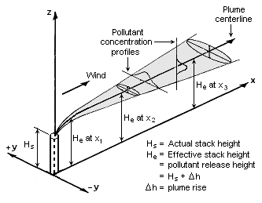

# Gaussian Plume Model Evaluation Against Turbulent Simulation Data

Ted Balabanski

*Developed for Virginia Tech's AOE 5154 - Data Analysis in Fluid Dynamics*

Gaussian Plume model schematic courtesy of [English wikipedia](https://commons.wikimedia.org/wiki/File:Gaussian_Plume.png)

## Background

The Gaussian Plume Model is a widely-used model for air contaminant transport in environmental engineering applications. The Gaussian Plume model is given by the following equation

$$C = \left[ \frac{J_0}{U_0} \right] \left[ \frac{1}{\sigma_2 \sqrt{2 \pi}} \exp \left( \frac{-x_2^2}{2 \sigma_2^2} \right) \right] \left[ \frac{1}{\sigma_3 \sqrt{2 \pi}} \exp \left( \frac{- (x_3 - H)^2}{2 \sigma_3^2} \right) \right]$$

where $C$ is the concentration, $J_0$ is the mass flow rate of the contaminant species, $U_0$ is the mean wind speed in the $x_1$ direction, $H$ is the effective stack height (accounting for plume rise), $x_2$ and $x_3$ are the transverse and vertical coordinates, and $\sigma_2$ and $\sigma_3$ are the variances of the Gaussians in the transverse and vertical directions.

This project aims to examine the efficacy of the Gaussian Plume model against a turbulent mean-wind driven flow of smoke particles.

The dataset used is the [TURB-Smoke][https://www.nature.com/articles/s41597-026-06774-7] dataset by Biferale and collaborators.
